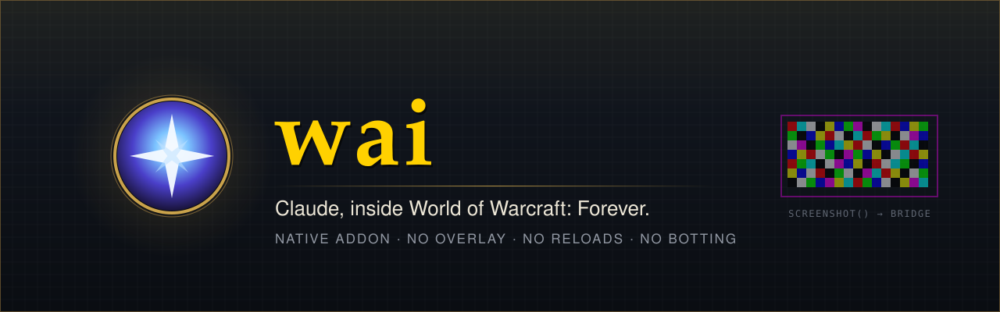
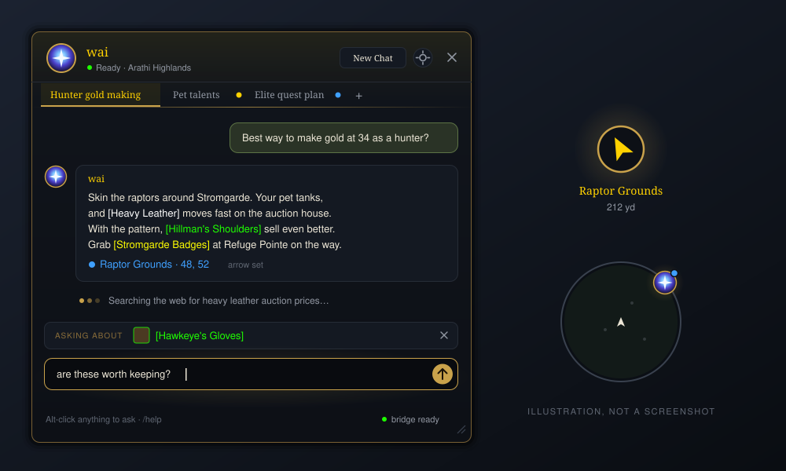
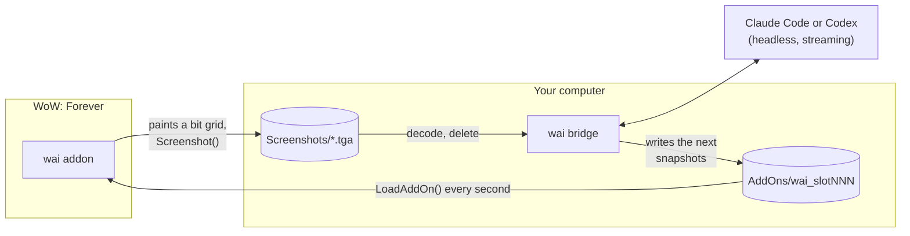

<p align="center">
  
</p>

<p align="center">
  <a href="https://github.com/dan-myles/wai/releases/latest"></a>
  <a href="https://github.com/dan-myles/wai/actions/workflows/ci.yml"></a>
  
  
</p>

<p align="center">
  <b>Ask Claude or Codex anything without leaving Azeroth.</b><br>
  A native addon with its own chat window, waypoint arrow and live UI.<br>
  No overlay, no reloads, no other addons, and nothing that plays the game for you.
</p>

<p align="center">
  <a href="#install">Install</a> ·
  <a href="#in-game">In game</a> ·
  <a href="#how-it-works">How it works</a> ·
  <a href="#cli">CLI</a> ·
  <a href="#development">Development</a>
</p>

<br>

<p align="center">
  
</p>

## Highlights

<table>
  <tr>
    <td width="50%" valign="top">
      <h4>💬 A chat window that belongs in WoW</h4>
      Dark slate, thin gold lines, Friz Quadrata titles. Replies stream in with a typewriter,
      and a live line shows what the agent is doing ("Searching the web for …").
    </td>
    <td width="50%" valign="top">
      <h4>🔗 Replies you can click</h4>
      Items, spells and quests come back as real links with tooltips. Places become blue pins
      that point wai's own waypoint arrow at them.
    </td>
  </tr>
  <tr>
    <td valign="top">
      <h4>🎯 Ask about anything</h4>
      Alt-click an item, a quest, your target's portrait or a name in chat. Quest dialogs get
      an <i>Ask wai</i> button. wai sees your character, zone, quests, recent chat and fights.
    </td>
    <td valign="top">
      <h4>🗂️ Parallel chats</h4>
      Up to 8 tabs per character, each its own agent session. wai keeps tab titles
      current; a name you give a tab sticks.
    </td>
  </tr>
  <tr>
    <td valign="top">
      <h4>🧩 UI on request</h4>
      "Show me a tracker for…" and wai writes a module that appears in game within seconds.
      No reload.
    </td>
    <td valign="top">
      <h4>🧠 Memory and actions</h4>
      Each character has its own memory. wai saves notes, sets the arrow and writes your
      macros on its own, with no commands to learn.
    </td>
  </tr>
  <tr>
    <td valign="top">
      <h4>🤝 Claude or Codex</h4>
      Pick who answers in <code>/settings</code>. Switch mid-chat and the conversation comes
      along: the new agent gets the recent messages.
    </td>
    <td valign="top">
      <h4>🔒 Private by default</h4>
      Everything runs on your machine through your own CLI login. Error reports are off unless
      you opt in, and never include chats or names.
    </td>
  </tr>
  <tr>
    <td valign="top">
      <h4>📺 Video, TikTok mode, killstreaks</h4>
      Pixel-art guide clips, a vertical TikTok dock with stream chat, and a Chopper Gunner at
      11 kills and a Nuke at 25. All cosmetic, all in <code>/fun</code>.
    </td>
    <td valign="top">
      <h4>🔄 Updates itself</h4>
      One binary per platform. <code>/update</code> in game or <code>wai update</code> in a
      terminal, with checksums on every download.
    </td>
  </tr>
</table>

## Install

You need **WoW: Forever** and an agent CLI, signed in once:
[Claude Code](https://claude.ai/install) (`claude`) or [Codex](https://github.com/openai/codex) (`npm install -g @openai/codex`, then `codex`). Have both? Pick in `/settings`.
Running [CLIProxyAPI](https://github.com/router-for-me/CLIProxyAPI)? `wai proxy on --key <key>` sends both agents through it.

**macOS**

```sh
curl -fsSL https://raw.githubusercontent.com/dan-myles/wai/main/install.sh | sh
```

**Windows (PowerShell)**

```powershell
& ([scriptblock]::Create((irm https://raw.githubusercontent.com/dan-myles/wai/main/install.ps1)))
```

Then **restart WoW** and type `/wai`.

The installer picks the right binary, checks its SHA-256 and puts it in `~/.local/bin`. It then runs `wai install`, which finds WoW: Forever, links the addon and starts the bridge at login.

<details>
<summary><b>Private repo, custom WoW path, pinned version</b></summary>

<br>

The repo is private, so sign in with the GitHub CLI first (`gh auth login`). The installer then downloads through `gh`. To fetch the script itself:

```sh
gh api repos/dan-myles/wai/contents/install.sh -H "Accept: application/vnd.github.raw" | sh
```

| Option | macOS / Linux | Windows |
|---|---|---|
| Pin a version | `--version v0.6.0` | `-Version v0.6.0` |
| WoW somewhere else | `--wow "<path to _forever_>"` | `-WowDir "<path to _forever_>"` |

</details>

## In game

`/wai` opens the window. You can also set a key in `/settings` → Toggle wai (it opens and closes the window), or click the minimap button.

| Command | |
|---|---|
| `/help` | what wai can do |
| `/new` | start a fresh conversation in this tab |
| `/settings` | agent (Claude or Codex), a key to open wai, typing speed, whisper replies, killstreaks, privacy, window positions, stable or nightly updates (or the ⚙ in the header) |
| `/fun` | toggles and test buttons for TikTok mode, killstreaks and video |
| `/update` | update wai without leaving the game |
| `/reload` | reload the UI |

Everything else, just ask. Some things to try:

> *"Where do I turn in this quest?"* · *"Is this an upgrade for a hunter?"* · *"Why did I die?"* ·
> *"Make me a mouseover heal macro"* · *"Make me a frame that tracks my soul shards"* · *"Show me a guide for the Deadmines"* · *"Turn on TikTok mode"*

**Copying:** click any message to select its text, then press Ctrl+C. Esc puts it back.

**Minimap button:** left-click for chat, right-click for settings, shift-right-click for fun. Drag it around the ring. Its dot pulses blue while wai works and turns gold when a reply is waiting.

## How it works

WoW addons can't touch the network or files. wai uses two things the client does allow: taking screenshots, and loading addons on demand.



- **Out:** each message is painted as a 128×64 grid of coloured blocks in a magenta frame, 3 bits per block (one per colour channel). The addon takes a lossless TGA screenshot; the bridge decodes it and deletes the file.
- **In:** 500 load-on-demand `wai_slotNNN` addons. Loading one reads its file from disk at that moment, so the bridge writes snapshots into the slots the addon will load next. A heartbeat and re-sync keep long replies flowing.
- **Live UI and video** use the same trick with their own pools: 40 module slots for UI the agent writes, and 200 slots for 80×45 pixel video frames.
- **Fallback:** `WaiDB.outbox` flushes on reload and `Data.lua` keeps history. Sequence numbers make resends harmless.
- **The agent:** every prompt carries [`apps/cli/SKILL.md`](apps/cli/SKILL.md), which teaches the agent the game, the reply markup (`[[item:…]]`, `[[setway:…]]`, `[[remember:…]]`…) and how to build UI.

> [!NOTE]
> wai reads game state, shows information and builds UI. It never automates gameplay.

## CLI

| Command | |
|---|---|
| `wai install [--wow <path>]` | link the addon, create the slots, start the bridge at login |
| `wai update` | update to the latest release |
| `wai status` | check everything wai needs (alias `doctor`) |
| `wai logs [-f]` | show or follow the bridge log |
| `wai agent [claude\|codex]` | show or choose which agent answers |
| `wai track [stable\|nightly]` | show or choose the update track |
| `wai proxy [on\|off\|<url>] [--key k] [--model m]` | send both agents through [CLIProxyAPI](https://github.com/router-for-me/CLIProxyAPI) or another gateway |
| `wai telemetry [on\|off\|show\|url <url>]` | anonymous error reports |
| `wai uninstall [--purge]` | remove wai from WoW and login items |

### Privacy

Telemetry is **off** until you opt in, through the banner, `/settings` → Privacy, or `wai telemetry on`. Reports carry scrubbed errors and versions only, never chat text or character names. `wai telemetry show` prints exactly what was sent. Details are in [docs/TELEMETRY.md](docs/TELEMETRY.md).

## Development

A Bun + Turborepo monorepo, driven by [Task](https://taskfile.dev).

```
apps/
  cli/         the bridge and the wai CLI (Bun, compiled per platform)
  addon/       the WoW addon (Lua 5.1) and its headless test suite
  telemetry/   the opt-in error report collector
tooling/       shared TypeScript, oxfmt and oxlint presets
docs/          DESIGN.md (visual language), TELEMETRY.md
```

```sh
task install   # dependencies
task setup     # link this checkout's addon into WoW
task dev       # run the bridge from source
task ci        # format, lint, typecheck, tests (addon tests need luajit)
task build     # binaries for every platform into apps/cli/dist
```

To release, bump `apps/cli/package.json` and `apps/addon/wai.toc` and add a `CHANGELOG.md` section. Run `task release:check VERSION=x.y.z`, then push a `vx.y.z` tag. GitHub Actions builds every platform and publishes the release, and `wai update` picks it up.

<details>
<summary><b>Debugging</b></summary>

<br>

- Lua errors print as `wai error:` in chat. They're also saved to `WTF/SavedVariables/Blizzard_Console.lua` on reload.
- `wai status` checks the install, and `wai logs -f` follows the bridge.
- New addon files and textures need a full WoW restart, not just `/reload`.

</details>

**More:** [AGENTS.md](AGENTS.md) (contributor rules) · [docs/DESIGN.md](docs/DESIGN.md) (design language) · [CHANGELOG.md](CHANGELOG.md) · [PARKING_LOT.md](PARKING_LOT.md) (ideas)

<br>

<p align="center"><sub>wai doesn't depend on any other addon. It isn't affiliated with or endorsed by Blizzard Entertainment.</sub></p>
