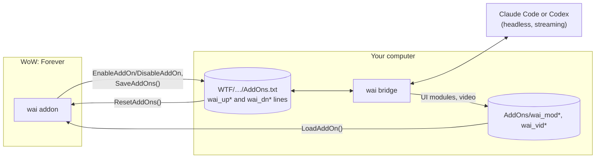

<p align="center">
  
</p>

<p align="center">
  <a href="https://github.com/dan-myles/wai/releases/latest"></a>
  <a href="https://github.com/dan-myles/wai/actions/workflows/ci.yml"></a>
  
  
</p>

<p align="center">
  <b>Ask Claude or Codex anything without leaving Azeroth.</b><br>
  A native addon with its own chat window, waypoint arrow and live UI.<br>
  No overlay, no reloads, no other addons, and nothing that plays the game for you.
</p>

<p align="center">
  <a href="#install">Install</a> ·
  <a href="#in-game">In game</a> ·
  <a href="#how-it-works">How it works</a> ·
  <a href="#cli">CLI</a> ·
  <a href="#development">Development</a>
</p>

<br>

<p align="center">
  
</p>

## Highlights

<table>
  <tr>
    <td width="50%" valign="top">
      <h4>💬 A chat window that belongs in WoW</h4>
      Dark slate, thin gold lines, Friz Quadrata titles. Replies stream in with a typewriter,
      and a live line shows what the agent is doing ("Searching the web for …").
    </td>
    <td width="50%" valign="top">
      <h4>🔗 Replies you can click</h4>
      Items, spells and quests come back as real links with tooltips. Places become blue pins
      that point wai's own waypoint arrow at them.
    </td>
  </tr>
  <tr>
    <td valign="top">
      <h4>🎯 Ask about anything</h4>
      Alt-click an item, a quest, your target's portrait or a name in chat. Quest dialogs get
      an <i>Ask wai</i> button. wai sees your character, zone, quests, recent chat and fights.
    </td>
    <td valign="top">
      <h4>🗂️ Parallel chats</h4>
      Up to 8 tabs per character, each its own agent session. wai keeps tab titles
      current; a name you give a tab sticks.
    </td>
  </tr>
  <tr>
    <td valign="top">
      <h4>🧩 UI on request</h4>
      "Show me a tracker for…" and wai writes a module that appears in game within seconds.
      No reload.
    </td>
    <td valign="top">
      <h4>🧠 Memory and actions</h4>
      Each character has its own memory. wai saves notes, sets the arrow, writes your
      macros and installs addons from CurseForge (one click to confirm), with no commands to learn.
    </td>
  </tr>
  <tr>
    <td valign="top">
      <h4>🤝 Claude or Codex</h4>
      Pick who answers in <code>/settings</code>. Switch mid-chat and the conversation comes
      along: the new agent gets the recent messages.
    </td>
    <td valign="top">
      <h4>🔒 Private by default</h4>
      Everything runs on your machine through your own CLI login. Error reports are off unless
      you opt in, and never include chats or names.
    </td>
  </tr>
  <tr>
    <td valign="top">
      <h4>📺 Video, TikTok mode, killstreaks</h4>
      Pixel-art guide clips, a vertical TikTok dock with stream chat, and a Chopper Gunner at
      11 kills and a Nuke at 25. All cosmetic, all in <code>/settings</code> → Fun.
    </td>
    <td valign="top">
      <h4>🔄 Updates itself</h4>
      One binary per platform. <code>/update</code> in game or <code>wai update</code> in a
      terminal, with checksums on every download.
    </td>
  </tr>
</table>

## Install

You need **WoW: Forever** and an agent CLI, signed in once:
[Claude Code](https://claude.ai/install) (`claude`) or [Codex](https://github.com/openai/codex) (`npm install -g @openai/codex`, then `codex`). Have both? Pick in `/settings`.
Running [CLIProxyAPI](https://github.com/router-for-me/CLIProxyAPI)? `wai proxy on --key <key>` sends both agents through it.

**macOS**

```sh
curl -fsSL https://raw.githubusercontent.com/dan-myles/wai/main/install.sh | sh
```

**Windows (PowerShell)**

```powershell
& ([scriptblock]::Create((irm https://raw.githubusercontent.com/dan-myles/wai/main/install.ps1)))
```

Then **restart WoW** and type `/wai`.

The installer picks the right binary, checks its SHA-256 and puts it in `~/.local/bin`. It then runs `wai install`, which finds WoW: Forever, links the addon and starts the bridge at login.

<details>
<summary><b>Private repo, custom WoW path, pinned version</b></summary>

<br>

The repo is private, so sign in with the GitHub CLI first (`gh auth login`). The installer then downloads through `gh`. To fetch the script itself:

```sh
gh api repos/dan-myles/wai/contents/install.sh -H "Accept: application/vnd.github.raw" | sh
```

| Option | macOS / Linux | Windows |
|---|---|---|
| Pin a version | `--version v0.6.0` | `-Version v0.6.0` |
| WoW somewhere else | `--wow "<path to _forever_>"` | `-WowDir "<path to _forever_>"` |

</details>

## In game

`/wai` opens the window. You can also set a key in `/settings` → Toggle wai (it opens and closes the window), or click the minimap button.

| Command | |
|---|---|
| `/help` | what wai can do |
| `/new` | start a fresh conversation in this tab |
| `/settings` | General (agent, your wai key, typing speed, whisper replies, window positions), Fun (TikTok mode, killstreaks, try-it buttons), About (privacy, stable or nightly updates). Also the ⚙ in the header |
| `/update` | update wai without leaving the game |
| `/reload` | reload the UI |

Everything else, just ask. Some things to try:

> *"Where do I turn in this quest?"* · *"Is this an upgrade for a hunter?"* · *"Why did I die?"* ·
> *"Make me a mouseover heal macro"* · *"Install Details"* · *"Make me a frame that tracks my soul shards"* · *"Show me a guide for the Deadmines"* · *"Turn on TikTok mode"*

**Copying:** click any message to select its text, then press Ctrl+C. Esc puts it back.

**Minimap button:** left-click for chat, right-click for settings, shift-right-click for the Fun tab. Drag it around the ring. Its dot pulses blue while wai works and turns gold when a reply is waiting.

## How it works

WoW addons can't touch the network or files. wai uses two things the client does allow: turning addons on and off (which the client saves to `AddOns.txt` the moment you ask), and loading addons on demand.



- **The link:** 2,048 empty helper addons are two lanes of bits, 128 bytes each way. The addon writes a frame into its lane by switching helpers on and off and saving; the bridge reads it from the character's `AddOns.txt`, writes its own lane into the same file, and the addon reads that back with `ResetAddOns()`. Every frame carries a sequence number, an ack of the other lane and a CRC, so each side sends its next frame as soon as the last one is confirmed (about one frame per game frame while a message moves). Nothing shows on screen, and the link never runs out.
- **Small messages:** the addon's messages are deflated when the client supports it, and the bridge only ever sends what changed: new messages, the new part of a streaming reply, and fields that moved. Opening the AddOns list pauses the link so your choices there are kept.
- **Live UI and video** load through load-on-demand slots: 40 for UI the agent writes, and 200 for 80×45 pixel video frames.
- **Fallback:** `WaiDB.outbox` flushes on reload and `Data.lua` keeps history. Sequence numbers make resends harmless.
- **The agent:** every prompt carries [`apps/cli/SKILL.md`](apps/cli/SKILL.md), which teaches the agent the game, the reply markup (`[[item:…]]`, `[[setway:…]]`, `[[remember:…]]`…) and how to build UI.
- **Wowhead:** the bridge also gives each run its own `wai mcp` server with `search` and `lookup` tools for Wowhead's Forever database (names to IDs, tooltips, and NPC and object coordinates for the waypoint arrow) and `curseforge`, which checks a CurseForge project for a Forever build. Full pages go through the agent's web fetch.
- **The game answers questions too:** the agent's `game` tool asks the running client over the link. It knows Forever's class trainer table (every ability and rank by level and cost, from [WhatsTraining](https://github.com/fusionpit/WhatsTraining)'s Forever data, MIT) and, if you have Questie, its Forever database: NPC and object spawns, quest givers and turn-ins, class trainers and town services like bankers and flight masters.
- **Everloot:** `everloot_search` and `everloot` read [Everloot](https://everloot.app)'s player-observed Forever data (what vendors sell, drops, what's near a spot, talent builds, realm prices, official hotfix notes). Only its Forever tools are allowed, with the version pinned to Forever.
- **Accuracy:** agents can only read wowhead.com and curseforge.com (Claude's permission rules, Codex's search domains), plus Everloot through wai's own tools. The game's own data (talent trees, spellbook, and every trainer and vendor you open) goes with messages about them and beats any website. After each reply the bridge checks the NPCs, items, spells, quests and NPC waypoints it names against Wowhead's Forever database and flags mismatches under the reply.
- **Addons:** `[[addon:ProjectID:Name]]` renders an Install link. Clicking it asks the bridge, which downloads the project's newest Forever build from CurseForge and unpacks it into `Interface/AddOns`. CurseForge is the only source, and wai's own folders are never replaced.

> [!NOTE]
> wai reads game state, shows information and builds UI. It never automates gameplay.

## CLI

| Command | |
|---|---|
| `wai install [--wow <path>]` | link the addon, create the helper addons, start the bridge at login |
| `wai update` | update to the latest release |
| `wai status` | check everything wai needs (alias `doctor`) |
| `wai logs [-f]` | show or follow the bridge log |
| `wai agent [claude\|codex]` | show or choose which agent answers |
| `wai track [stable\|nightly]` | show or choose the update track |
| `wai proxy [on\|off\|<url>] [--key k] [--model m]` | send both agents through [CLIProxyAPI](https://github.com/router-for-me/CLIProxyAPI) or another gateway |
| `wai telemetry [on\|off\|show\|url <url>]` | anonymous error reports |
| `wai uninstall [--purge]` | remove wai from WoW and login items |

### Privacy

Telemetry is **off** until you opt in, through the banner, `/settings` → Privacy, or `wai telemetry on`. Reports carry scrubbed errors and versions only, never chat text or character names. `wai telemetry show` prints exactly what was sent. Details are in [docs/TELEMETRY.md](docs/TELEMETRY.md).

## Development

A Bun + Turborepo monorepo, driven by [Task](https://taskfile.dev).

```
apps/
  cli/         the bridge and the wai CLI (Bun, compiled per platform)
  addon/       the WoW addon (Lua 5.1) and its headless test suite
  telemetry/   the opt-in error report collector
tooling/       shared TypeScript, oxfmt and oxlint presets
docs/          DESIGN.md (visual language), TELEMETRY.md
```

```sh
task install   # dependencies
task setup     # link this checkout's addon into WoW
task dev       # run the bridge from source
task ci        # format, lint, typecheck, tests (addon tests need luajit)
task build     # binaries for every platform into apps/cli/dist
```

To release, bump `apps/cli/package.json` and `apps/addon/wai.toc` and add a `CHANGELOG.md` section. Run `task release:check VERSION=x.y.z`, then push a `vx.y.z` tag. GitHub Actions builds every platform and publishes the release, and `wai update` picks it up.

<details>
<summary><b>Debugging</b></summary>

<br>

- Lua errors print as `wai error:` in chat. They're also saved to `WTF/SavedVariables/Blizzard_Console.lua` on reload.
- `wai status` checks the install, and `wai logs -f` follows the bridge.
- New addon files and textures need a full WoW restart, not just `/reload`.

</details>

**More:** [AGENTS.md](AGENTS.md) (contributor rules) · [docs/DESIGN.md](docs/DESIGN.md) (design language) · [CHANGELOG.md](CHANGELOG.md) · [PARKING_LOT.md](PARKING_LOT.md) (ideas)

<br>

<p align="center"><sub>wai doesn't depend on any other addon. It isn't affiliated with or endorsed by Blizzard Entertainment.</sub></p>
